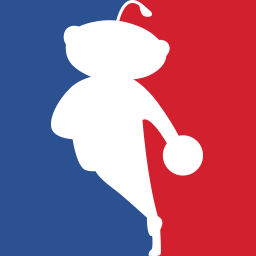

# NBA Team Subreddit Manager

Automatically update a subreddit's sidebar with useful information about your favorite team. Originally made for [r/NBASpurs](https://reddit.com/r/NBASpurs).

### Current Features

* Updates both new and old Reddit
* Creates Markdown tables containing the team's schedule, standings, and roster
* Can be automated using GitHub Actions or deployed on your own machine
